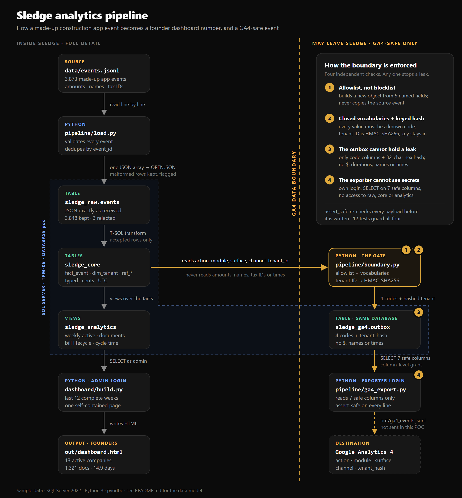

# Sledge analytics proof of concept

A small pipeline that loads made-up construction app events into SQL Server, a founder dashboard built on top of it, and the GA4-safe version of every event.

Everything in the sample is invented: company names, tax IDs, amounts and timings.



The left side keeps full detail and feeds the founder dashboard. Only one arrow crosses the GA4 boundary, and it passes four independent checks, numbered on the diagram. The editable source is [docs/architecture.svg](docs/architecture.svg); redraw it with `python docs/make_architecture.py`.

## What is here

| Deliverable | Where |
|---|---|
| Sample events (3,873 lines, including 25 re-deliveries and 3 malformed events) | `data/events.jsonl` |
| Pipeline: generate, validate, load, transform | `pipeline/`, `sql/001_schema.sql` |
| Founder dashboard (one self-contained HTML file) | `out/dashboard.html` |
| GA4-safe version of each event (3,845 lines) | `out/ga4_events.jsonl` |
| Boundary tests | `tests/test_boundary.py` |

## Run it

Needs Python 3.10+, SQL Server 2017 or later, and Microsoft ODBC Driver 17 or 18 for SQL Server.

```
pip install -r requirements.txt
copy .env.example .env          # then fill in server and login
python main.py --reset
python -m unittest discover -s tests -v
```

Connection settings are read from `.env` (see `.env.example`). Leave `SQLSERVER_USER` empty to use Windows authentication.

What `main.py` does to the server:

- Creates the `sledge_poc` database if it does not exist.
- Creates four `sledge_*` schemas inside that database.
- Creates a SQL login and database user named `sledge_ga4_exporter`.

The login in `.env` therefore needs permission to create databases and logins, and the server must allow SQL Server authentication (mixed mode). `--reset` drops and rebuilds the four schemas only. Without it, a re-run loads nothing new: every step is idempotent.

The GA4 file contains Measurement Protocol request bodies. Nothing is sent to GA4.

## Data model

Module names and document types follow Sledge's own product navigation (Bills, Invoices, Contracts, Lien Waivers, COIs, Change Orders, Pay Packages).

**An event** is one thing that happened to one document:

```json
{"event_id": "a8e7…", "event_name": "invoice_created", "occurred_at": "2026-07-20T07:51:18Z",
 "tenant_id": "tnt_0003", "company_name": "Northgate Builders Group", "tax_id": "00-7110724",
 "user_id": "usr_0305", "actor_type": "user",
 "action": "created", "module": "invoices", "surface": "web_app", "channel": "direct",
 "document_id": "INV-00051", "amount": 2221.29,
 "counterparty_name": "Orchard Street Holdings", "processing_ms": 2242}
```

- `action`, `module`, `surface` and `channel` are closed vocabularies. `surface` is where it happened (web app, mobile app, client/vendor portal, background). `channel` is how the document moved (email, upload, mobile scan, e-signature, ACH, card, check, integration, or direct entry).
- `event_name` comes from a registry of 18 events, each tied to one module and one action.
- `actor_type` says who acted: a `user` at the company, the Sledge `agent`, or an `external` party such as a vendor signing a waiver.

**The database has four schemas**, one per trust level:

| Schema | Contents | Sensitive |
|---|---|---|
| `sledge_raw` | `events`: the JSON exactly as received, keyed by `event_id`, marked accepted or rejected with a reason | Yes |
| `sledge_core` | `fact_event` (one typed row per event, money in integer cents, times in UTC), `dim_tenant` (company name, tax ID), and one lookup table per vocabulary | Yes |
| `sledge_analytics` | Views the dashboard reads: `weekly_active_companies`, `documents`, `bill_lifecycle`, `bill_cycle_time_weekly` | Yes |
| `sledge_ga4` | `outbox`: four vocabulary codes and a hashed tenant ID, one row per event | No |

SQL Server has no enum type, so each categorical column has a foreign key to its lookup table (`sledge_core.ref_action` and so on). Those columns use a binary collation, so `ACH` does not match `ach`.

The load is raw first, then transform in T-SQL. Rows go to the server as one JSON array per step and are unpacked there with `OPENJSON`. Re-delivered events are dropped on the `event_id` primary key. Malformed events are kept in `raw` with the reason and go no further, so nothing is silently lost and nothing unvalidated reaches the warehouse.

**Metric definitions**

- **Weekly active companies**: companies with one or more `user` actions in a Monday to Sunday week (UTC). Agent and external activity is excluded on purpose. Otherwise every company with a connected inbox would count as active forever, because the agent keeps reading its bills.
- **Documents processed per module**: distinct documents, each counted once in the week it first appears.
- **Bill received to paid**: per paid bill, first `bill_paid` minus first `bill_received`, averaged by the week of payment. The dashboard shows the median next to the average because a few slow bills pull the average up, and shows the count of unpaid bills because they are not in the average at all.

On the sample: 13 active companies in the latest week, 1,321 documents over twelve weeks, and 14.9 days average (12.7 median) from received to paid across 512 bills.

## The GA4 boundary

GA4 receives five things per event and nothing else:

```json
{"client_id": "17cce8f54137e56a60582a1d80421263",
 "events": [{"name": "invoice_created",
             "params": {"action": "created", "module": "invoices", "surface": "web_app",
                        "channel": "direct", "tenant_hash": "17cce8f54137e56a60582a1d80421263"}}]}
```

`client_id` is required by GA4 and repeats the tenant hash. The event name is derived from module and action, so it carries no extra information.

The boundary is enforced in four independent places. Each one would stop a leak on its own.

1. **Allowlist, not blocklist.** `pipeline/boundary.py` is the only code that builds GA4 payloads. It constructs a new object from five named fields and never copies the source event. A sensitive field added to events next month is excluded by default, with no code change.
2. **Values are checked, not only keys.** Each of the four categorical fields must be a member of its closed vocabulary. A company name typed into `channel` raises an error instead of passing through, and the error message does not repeat the value. The sample includes one such event to prove it.
3. **The database cannot hold a leak.** `sledge_ga4.outbox` has four 16-character columns that must match a vocabulary code exactly, and one `tenant_hash` column whose check constraint allows only 32 lowercase hex characters. There is no column for a name, dollars, a duration or an event timestamp.
4. **The exporter cannot read sensitive data.** The export logs in as `sledge_ga4_exporter`, which has column-level `SELECT` on the safe outbox columns and `UPDATE` on `exported_at`, and nothing else. It has no access to `raw`, `core` or `analytics`, and cannot read the outbox's link back to the source event. A bug in the exporter cannot leak what the exporter cannot query.

Before each line is written, `assert_safe` re-checks the exact payload: exact key set, every value, hash format.

**Two details that are easy to get wrong**

- **The tenant hash is keyed.** It is HMAC-SHA256 with a secret that stays inside Sledge. Tenant IDs are short and guessable, so a plain SHA-256 could be reversed by hashing every candidate ID.
- **Durations can leak without a duration field.** If GA4 received exact timestamps and a document ID, anyone could subtract "received" from "paid". So the payload has no timestamp (GA4 records arrival time), no event ID and no document ID, and the export order is shuffled.

**Tests** (`tests/test_boundary.py`, 12 tests, all passing):

- Every sample event reduces to exactly the five fields.
- No company name, counterparty name, tax ID, tenant ID, user ID, document ID, amount or timestamp from the input appears anywhere in the output.
- The exporter login is denied on every sensitive table and column, and cannot delete or change outbox rows.
- The outbox rejects unknown codes, wrong case, raw tenant IDs, uppercase hex and trailing spaces. These cases run inside a transaction that is rolled back.
- The Python vocabularies match the lookup tables.

## What I would do next

- Deduplication on the GA4 side. The outbox marks rows as exported, which gives at-least-once delivery. A crash between sending and marking could send a batch twice.
- Row-level security on the `core` tables, so tenant isolation in the warehouse matches the production database.
- Encrypt `tax_id` at rest (Always Encrypted or column encryption), and keep the HMAC key in a secret store with a rotation plan. Rotating the key changes every tenant hash, so GA4 history would restart.
- Run the same boundary tests in CI on every change that touches event tracking.
